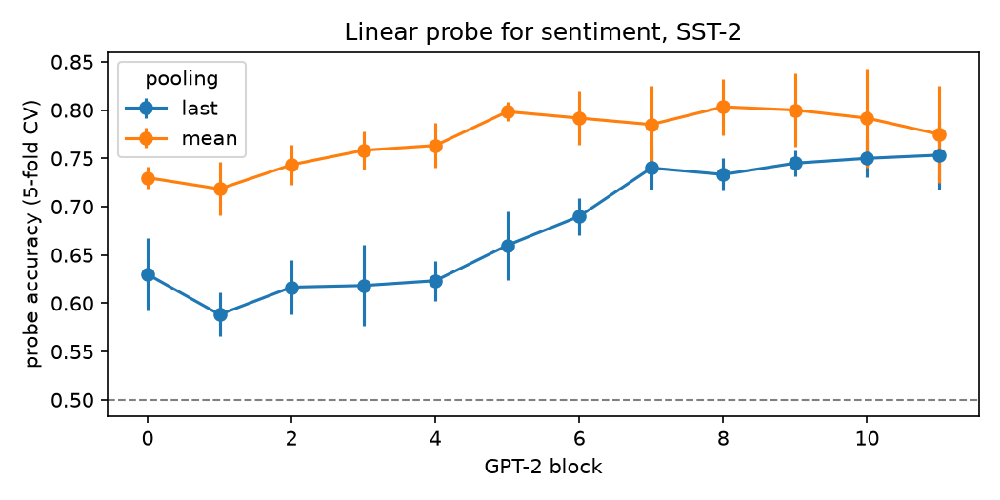
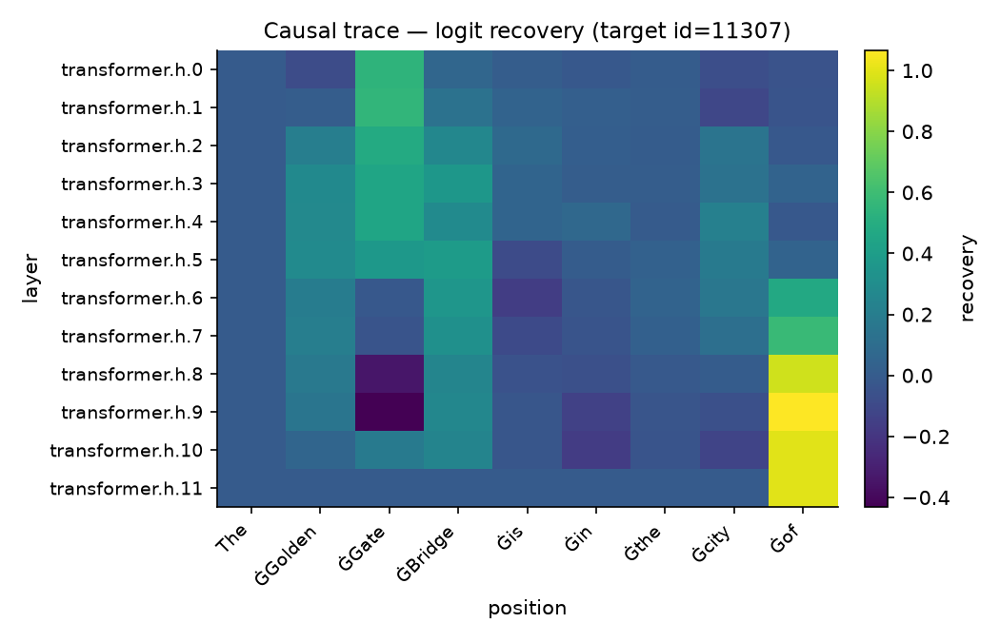

# NNDbg — a diagnostic toolkit for neural networks

[](https://github.com/Darsh-Nandu/neural-network-debugger/actions)
[](https://www.python.org)
[](LICENSE.md)

NNDbg wraps a PyTorch or HuggingFace model in a single `Inspector` and
answers the questions people actually ask when interpreting a neural
network: where a concept is encoded, which inputs caused an output, what
each attention head is doing, which layer causally produces a behaviour,
what features a layer's activations decompose into, and how similar the
representations of different layers (or different models) are.

## Analysis planes

| `inspector.<plane>` | Answers | Method |
|---|---|---|
| `probing` | Where is concept X encoded? | cross-validated linear / SVM / MLP probes |
| `attribution` | Which inputs caused this output? | saliency, gradient×input, SmoothGrad, IG, Grad-CAM |
| `attention` | What does each head attend to? | per-head heatmaps, rollout, entropy |
| `patching` | Which layers causally produce a behaviour? | causal tracing, mean ablation |
| `sae` | What sparse features does a layer learn? | sparse autoencoder (ReLU or top-k) |
| `latent` | Where do activations sit in a compressed space? | VAE latent space + anomaly detection |
| `geometry` | How similar are layers to each other (or to another model)? | linear CKA, PCA, UMAP |
| `neurons` | What is each neuron doing? | dead neurons, top examples, kurtosis |
| `erasure` | How do I remove a concept from representations? | INLP null-space projection |

Every result is a plain dataclass with a `.plot()` method (matplotlib,
zero-config) and an optional `.plotly()` method if you have `plotly` installed.

## Installation

```bash
pip install nndbg

# with interactive Plotly figures
pip install nndbg[plotly]
```

## Quick start

```python
from transformers import AutoModelForCausalLM, AutoTokenizer
from nndbg import Inspector

model = AutoModelForCausalLM.from_pretrained("gpt2")
tokenizer = AutoTokenizer.from_pretrained("gpt2")
inspector = Inspector(model, tokenizer)

inspector.summary()          # model + all available planes
inspector.layers()[:5]       # every layer name you can pass to any plane

# Attribution — which input tokens drove the prediction?
input_ids = tokenizer("The capital of France is", return_tensors="pt").input_ids
inspector.attribution.saliency(input_ids).plot()
inspector.attribution.smoothgrad(input_ids).plot()   # noise-averaged saliency

# Attention — what does head 0 of layer 0 attend to?
inspector.attention.heads(input_ids, layer=0).plot()
inspector.attention.rollout(input_ids).plot()         # cumulative information flow

# Probing — is sentiment decodable, and from which layer?
dataset = [
    (tokenizer(text, return_tensors="pt").input_ids, label)
    for text, label in [
        ("I love this movie", 1), ("I hate this movie", 0),
        ("This is wonderful", 1), ("This is terrible", 0),
    ]
]
inspector.probing.fit(dataset, concept="sentiment").plot()
inspector.probing.fit(dataset, concept="sentiment", method="svm").plot()
```

Any plain `nn.Module` works too — `tokenizer` is optional and only needed
for token-level labeling.

### Activation patching / causal tracing

```python
clean = tokenizer("The Brandenburg Gate is in the city of", return_tensors="pt").input_ids
corrupted = tokenizer("The Golden Gate Bridge is in the city of", return_tensors="pt").input_ids

# Causal trace: which (layer, position) recovers the clean prediction?
result = inspector.patching.causal_trace(
    clean, corrupted, layers=inspector.find_layers(r"h\.\d+$")
)
result.plot()  # (layer × position) logit-recovery heatmap

# Mean ablation: which positions carry above-average information?
corpus = [tokenizer(t, return_tensors="pt").input_ids for t in texts]
inspector.patching.mean_ablation(clean, corpus).plot()
```

### Sparse autoencoders and VAE latent analysis

```python
dataset = [tokenizer(t, return_tensors="pt").input_ids for t in texts]

# Sparse feature decomposition (ReLU or exact top-k)
inspector.sae.train(dataset, layer="transformer.h.6", n_features=512)
inspector.sae.train(dataset, layer="transformer.h.6", n_features=512, activation="topk:32")
inspector.sae.decompose(dataset, layer="transformer.h.6").plot()

# Compressed latent space + reconstruction-error anomaly detection
inspector.latent.train(dataset, layer="transformer.h.6", latent_dim=2)
result = inspector.latent.encode(dataset, layer="transformer.h.6")
result.plot()
result.anomalies()  # indices of outlier examples
```

### Representational geometry

```python
# How similar are the layers to each other?
layers = inspector.find_layers(r"h\.\d+$")
inspector.geometry.layer_similarity(dataset, layers=layers).plot()

# How much did fine-tuning change each layer?
base_inspector = Inspector(base_model, tokenizer)
inspector.geometry.compare(base_inspector, dataset, layers=layers).plot()

# 2-D PCA scatter of a layer's representations
inspector.geometry.pca(dataset, layer="transformer.h.6", labels=class_labels).plot()
```

### Neuron analysis and concept erasure

```python
# Dead neurons, top-activating examples, polysemanticity proxy
result = inspector.neurons.stats(dataset, layer="transformer.h.6.mlp.c_fc")
print(result)                          # NeuronResult(... dead=12/3072 ...)
result.plot()                          # bar chart, dead neurons in red
result.polysemantic_neurons()          # low-kurtosis (broadly-activating) indices

# Remove a concept from a layer's representations (INLP)
result = inspector.erasure.inlp(dataset, concept="sentiment", layer="transformer.h.4")
result.plot()                          # probe accuracy decay over iterations
erased = result.apply(some_activations)  # project new activations through erasure
```

## Worked example: sentiment in GPT-2 small

`examples/gpt2_sentiment.py` runs three planes on real data and saves the numbers in `examples/results/gpt2_sentiment.json`. Everything below comes from one run (600 SST-2 sentences, balanced, seed 0, CPU).

**Probing.** A logistic regression probe, 5-fold cross-validated, at every block:



| Pooling | Block 0 | Best block | Accuracy at best | Block 11 |
| :--- | :---: | :---: | :---: | :---: |
| mean over tokens | 73.0% | 8 | 80.3% | 77.5% |
| last token | 63.0% | 11 | 75.3% | 75.3% |

Sentiment is easiest to read from the middle of the network when you average over the sentence, and it only reaches the last token in the final blocks.

**Erasure.** INLP on block 8 removes one direction per iteration. The probe's training accuracy falls from 100% to 67.7% over 20 iterations, so the signal is spread over many directions, not one.

**Patching.** Clean prompt "The Brandenburg Gate is in the city of" (GPT-2 predicts " Berlin"), corrupted prompt "The Golden Gate Bridge is in the city of". Restoring the clean activation at block 9 on the last token recovers the " Berlin" logit fully (recovery 1.07). Early blocks matter at the landmark's name instead:



To reproduce:

```bash
pip install -e . datasets
python examples/gpt2_sentiment.py
```

The saved run took about 35 minutes on an 8-core laptop CPU that was busy with other work. These numbers are for GPT-2 small on 600 sentences. They show the tool working on a real model and should not be read as a general claim about where sentiment lives.

## Development

```bash
git clone https://github.com/Darsh-Nandu/neural-network-debugger
cd neural-network-debugger
pip install -e ".[dev]"
ruff check nndbg tests
pytest
```
